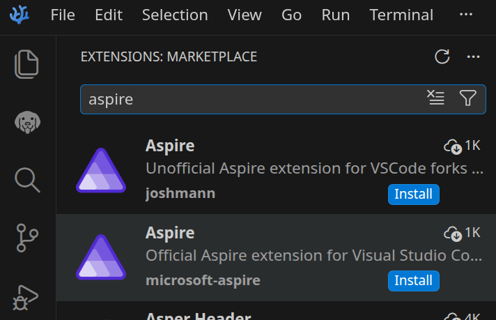
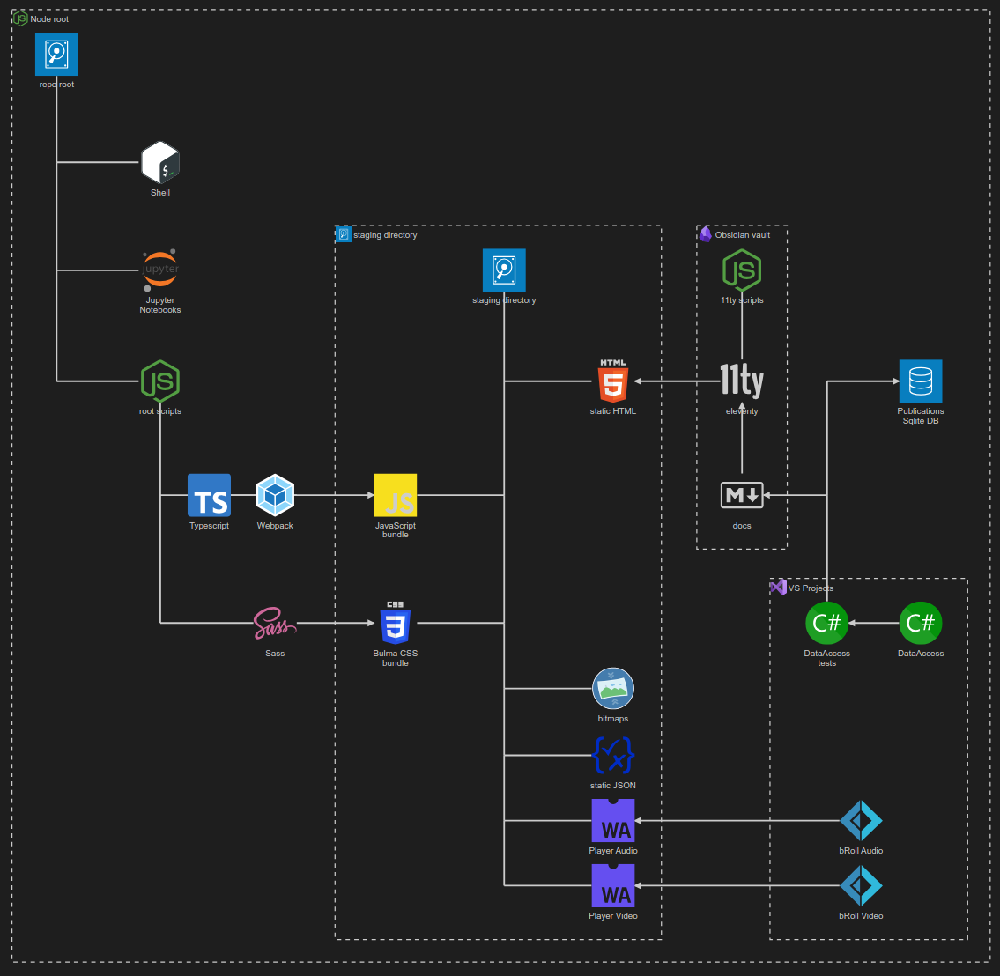

---json
{
  "documentId": 0,
  "title": "studio status report: 2026-08",
  "documentShortName": "2026-08-30-studio-status-report-2026-08",
  "fileName": "index.html",
  "path": "./entry/2026-08-30-studio-status-report-2026-08",
  "date": "2026-08-30T19:39:34.546Z",
  "modificationDate": "2026-08-30T19:39:34.546Z",
  "templateId": 0,
  "segmentId": 0,
  "isRoot": false,
  "isActive": true,
  "sortOrdinal": 0,
  "clientId": "2026-08-30-studio-status-report-2026-08",
  "tag": "{\n  \u0022extract\u0022: \u0022Month 08 of 2026 was about really understanding what Aspire is because my disagreement with Azure billing has led me off the path beaten to death by the co-author of Zero Day: A Novel. As modern developers, we are not supposed to be going around with the \\u2026\u0022\n}"
}
---

# studio status report: 2026-08

Month 08 of 2026 was about really understanding what [Aspire](https://www.youtube.com/watch?v=FPwAGfslTJM&pp=ygUTZGF2aWQgZm93bGVyIGFzcGlyZQ%3D%3D) is because my disagreement with Azure billing has led me off the path beaten to death by the co-author of [_Zero Day: A Novel_](https://search.worldcat.org/title/861615141). As modern developers, we are _not_ supposed to be going around with the expectation of installing our apps in the cloud _without_ containerization. My Azure billing issues have encouraged me to be that old guy 👴 trying hang out with the cool kids 😎 I am adding Aspire-first, back-end development skills to my mix 👏

<div style="text-align:center">

<figure>
    <a href="https://www.youtube.com/watch?v=FPwAGfslTJM">
        
    </a>
    <p><small>Why Everyone Will be Using .NET Aspire /w David Fowler</small></p>
</figure>

</div>

My disagreement with Azure billing appears to be over based what I am seeing in the Azure Portal from, like, last week:

<div style="text-align:center">


</div>

…to today:

<div style="text-align:center">


</div>

Here is my short list of anti-Azure-billing allegations that would be a waste of your time to reduce to the absurd:

- the sincerely concerned Microsoft support staff are not trained (or coached by <acronym title="Artificial Intelligence">AI</acronym>) to have any insight whatsoever into the specific issue(s) of the customer (the customer wastes time explaining shit to them instead of them telling me anything relevant or useful—with the help of AI)
- the culture of <acronym title="event-driven architecture">EDA</acronym> around Azure billing is completely absent because I never interacted with Microsoft support staff in the context of _my actions_ as a customer (e.g. staff should be eager to tell me _when_ I opted into something that would increase costs—AI can easily aggregate my events and show me what I did instead of everyone guessing politely)
- the lack of efficiency due to the lack of <acronym title="event-driven architecture">EDA</acronym> culture allows Microsoft to literally profit from _not_ using <acronym title="Artificial Intelligence">AI</acronym> where it is actually needed
- Azure charges so much for storage it _feels_ like they do this to drive people off the platform so they can use the resources (for their boil-the-ocean AI initiatives)
- Azure charges so much for storage that you cannot use almost all other Azure-based products which depend on Azure Storage
- when you find yourself reading these words on <https://songhayblog.azurewebsites.net/> this means I am still using a “free” Azure App Service that does _not_ have <acronym title="Content Delivery Network">CDN</acronym> support and does _not_ have free HTTPS (<acronym title="Transport Layer Security">TLS</acronym>) support for a custom domain _by default_ like [Netlify](https://www.netlify.com/) for example (as of this writing, Microsoft effectively charges at least $50/month for HTTPS and I did not bother to look into geo-locating)—in other words, I will probably be moving this Blog in a few months 🙁😓

It took me months to figure how to stop the bleeding with Azure billing: long story short, I had to disable billing for Azure DevOps _completely_ after _one_ sincerely concerned and effective Microsoft support person pointed out that I was being billed for something that I do not recall opting into. I _should_ have been able to see the name of the product I was being billed for and ‘turn off’ that product instead of cutting off everything. This experience pushed me over the edge and (with the help of AI—mostly the Google search AI) I think I get the message:

- the rest of the world’s cloud storage is (mostly) standardized around the AWS S3 <acronym title="Application Programming Interface">API</acronym> so I need to get with that because these S3 alternatives are far less expensive than these ‘new’ Microsoft offerings
- start with containerization _first_ on the back-end—and here is where Aspire has been the whole time—because containerization allows _everyone_ to shop around for the lowest price (previously, I thought that only big org’s on the Kubernetes level did this)

With the above in view, we can see why there has been a _new_ S3-related package release 📦🚀✨ from `SonghayCore` among the releases of the month (in chronological order):

- [Songhay.Modules 10.1.0](https://www.nuget.org/packages/Songhay.Modules/10.1.0)📦🚀
- [Songhay.Modules.Publications 10.1.0](https://www.nuget.org/packages/Songhay.Modules.Publications/10.1.0)📦🚀
- [Songhay.Modules.Bolero 10.1.0](https://www.nuget.org/packages/Songhay.Modules.Bolero/10.1.0)📦🚀
- [Songhay.Player.ProgressiveAudio 10.0.0](https://www.nuget.org/packages/Songhay.Player.ProgressiveAudio/10.0.0)📦🚀
- [SonghayCore 10.0.2](https://www.nuget.org/packages/SonghayCore/10.0.2) 📦🚀
- [SonghayCore.S3 10.0.1](https://www.nuget.org/packages/SonghayCore.S3/10.0.1) 📦🚀✨

This is too much work—especially during a heatwave—but when Microsoft starts getting drunk and starts hauling off and slapping dudes we gotta move… 🌬️👟

Selected notes of the month:

### Feedsmith is a simple way to visualize <acronym title="Really Simple Syndication">RSS</acronym> data, including <acronym title="Outline Processor Markup Language">OPML</acronym>

>Fast, all‑in‑one JavaScript feed parser and generator for RSS, Atom, RDF, and JSON Feed, with support for popular namespaces and OPML files.
>
>Feedsmith offers universal and format‑specific parsers that maintain the original feed structure in a clean, object-oriented format while intelligently normalizing legacy elements. Access all feed data without compromising simplicity.
>
>—<https://github.com/macieklamberski/feedsmith>
>

See “[Parsing Examples](https://v3.feedsmith.dev/parsing/examples)” 📖

## Songhay System Studio: “My TOP Patterns for Event Driven Architecture”

<div style="text-align:center">

<figure>
    <a href="https://www.youtube.com/watch?v=P5hq6iWn_p8">
        
    </a>
    <p><small>My TOP Patterns for Event Driven Architecture</small></p>
</figure>

</div>

1. the outbox pattern (when a publisher cannot publish)
2. the inbox pattern (when a subscriber/consumer cannot subscribe)
3. at-least-once delivery (to prevent duplicate messages… depends on the inbox pattern❔)
4. event choreography/orchestration
5. handling transient failures (e.g. using an “exponential back-off” and then terminating with a dead-letter queue or topic)

## .NET C♯: Facet is better than AutoMapper …

…but it is slower in part because of its code-generation features as shown in this Nick Chapsas video:

<div style="text-align:center">

<figure>
    <a href="https://www.youtube.com/watch?v=kiGG4fUe4RI">
        
    </a>
    <p><small>Stop Mapping in .NET Use Facets Instead</small></p>
</figure>

</div>

>**Facet** is a C# source generator that eliminates DTO boilerplate. Declare what you want, and Facet generates the type, constructor, LINQ projection, and reverse mapping, all at compile time with zero runtime overhead.
>
>—<https://github.com/Tim-Maes/Facet>
>

## a very tough <acronym title="Sassy CSS">SCSS</acronym> question for Google <acronym title="Artificial Intelligence">AI</acronym>

…`how do we set a CSS custom property with a scss variable value?`

>To set a CSS custom property (CSS variable) using a Sass (SCSS) variable, you must use **Sass interpolation** with the `#{}` syntax. [1](https://teamtreehouse.com/community/how-do-you-make-a-mixin-variable-value-to-set-the-name-of-a-new-class), [2](https://medium.com/@aryanvania03/sass-variable-in-css-calc-function-9376ab65ef4d), [3](https://www.koderhq.com/tutorial/sass/variable/)

```scss
// Define the SCSS variable
$brand-color: #ff5733;

:root {
  // Set the CSS custom property using interpolation
  --main-color: #{$brand-color};
}

.button {
  // Use the CSS custom property in your styles
  color: var(--main-color);
}
```

>Why Interpolation is Required
>
>Sass treats CSS custom properties literally to ensure maximum compatibility with native CSS features. If you write `--main-color: $brand-color;` without the `#{}` wrapper, Sass will compile it literally as `--main-color: $brand-color;`, which browsers cannot understand. Interpolation forces Sass to evaluate the variable and inject its actual value before compiling to CSS. [1](https://dev.to/frehner/making-css-vars-with-scss-vars-19dc), [2](https://sass-lang.com/documentation/breaking-changes/css-vars/), [3](https://www.ltvco.com/engineering/sass-variables-css-custom-properties/), [4](https://stackoverflow.com/questions/60469723/sass-mixin-pass-argument-as-css-variable)
>

## Astro: according to Google <acronym title="Artificial Intelligence">AI</acronym>, DOMPurify is needed 😐📦📦📦📦

…`can astro display santized chunks of HTML?`

>Yes, Astro can display chunks of HTML using the `set:html` directive, but it **does not sanitize** the content automatically. You must sanitize the HTML string yourself using a library like DOMPurify before passing it to Astro to prevent security risks like XSS. [1](https://github.com/withastro/astro/issues/1827), [2](https://vibeappscanner.com/vulnerability-in/xss-astro), [3](https://stackoverflow.com/questions/77567458/astro-js-display-html-from-json-data-content)
> 
> How to Display HTML in Astro
> 
> - Use the **`set:html`** directive on any HTML element to inject a raw string.
> 
> - Pass your variable directly: `<div set:html={sanitizedHTML} />`.
> 
> - Avoid curly braces alone like `<div>{rawHTML}</div>`, which will print out or escape the string text instead of rendering it as markup. [1](https://github.com/markedjs/marked/issues/1628), [2](https://docs.astro.build/de/reference/directives-reference/), [3](https://eastondev.com/blog/en/posts/dev/20251202-astro-seo-complete-guide/), [4](https://stackoverflow.com/questions/77567458/astro-js-display-html-from-json-data-content), [5](https://github.com/withastro/astro/issues/1827)
> 
> Recommended Sanitization Process
> 
> - Install a sanitization library like `isomorphic-dompurify` or `dompurify`.
> 
> - Sanitize your string on the server or during build time before assignment.
> 
> - Render the clean output safely inside your component template. [1](https://www.reddit.com/r/astrojs/comments/1dywtcu/best_approach_for_parsing_and_rendering_cms/)

## asking Google <acronym title="Artificial Intelligence">AI</acronym> about my <acronym title="Cascading Style Sheets">CSS</acronym> background-image problems 😐💄

…`what does the syntax look like for background-image being set by CSS variable?`

>The correct syntax for setting a `background-image` using a CSS variable requires ==storing the **entire `url()` function** (or gradient function) inside the variable itself==. [1](https://stackoverflow.com/questions/41748998/css-variables-with-background-image-url)
>
>Standard Syntax

```css
:root {
  /* Store the entire function inside the variable */
  --my-bg-image: url('https://example.com');
}

.hero-element {
  /* Call the variable directly */
  background-image: var(--my-bg-image);
}
```

>❌ The Common Mistake (What Doesn't Work)
>
>You **cannot** place a CSS variable inside the standard `url()` function like this: [1](https://www.iamtimsmith.com/blog/using-variables-in-css)

```css
/* THIS WILL NOT WORK */
:root {
  --image-path: 'https://example.com';
}
.hero-element {
  background-image: url(var(--image-path)); /* Browser treats "var(--image-path)" as a literal relative path string */
}
```

## Songhay Modules (F♯): I know that `FsUnit.xUnit` is causing xUnit.net problems 😐😠📦🔥

I generate a brand new test project and define a `type` for a test that is having `ITestOutputHelper` injected and it works fine. Then I install `FsUnit.xUnit` (<https://github.com/fsprojects/FsUnit>) and the error message is this:

```console
Xunit.Sdk.TestPipelineException
The following constructor parameters did not have matching fixture data: ITestOutputHelper testOutputHelper
  Exception doesn't have a stacktrace
```

I am so pissed that I am willing live my F♯ life without `FsUnit.xUnit`! It means I will be losing this:

```fsharp
actual |> should be (ofCase <@ Result<Uri,exn>.Error @>)
```

…which, comically, can be replaced with:

```fsharp
actual.IsError |> Assert.True
```

There has not been a release for over a year.

## .NET F♯: I have stumbled upon the “record of functions” pattern with an answer from Google <acronym title="Artificial Intelligence">AI</acronym> 😐🤔

…`in f# can a type composed of functions serve as an interface?`

>==Yes, a F# type made of functions can act like an interface==. You can use a record or a class where each field is a function. This pattern is often called record of functions. It lets you group related behaviors together. [1](https://fsharpforfunandprofit.com/posts/interfaces/), [2](https://learn.microsoft.com/en-us/dotnet/fsharp/what-is-fsharp), [3](https://medium.com/@dogwith1eye/prefer-records-of-functions-to-interfaces-d6413af4d2c3), [4](https://news.ycombinator.com/item?id=35436600)
> 
> How It Works
> 
> - Define a record type with function fields.
> - Create a value by filling the fields with real functions.
> - Pass the record around like an object or interface.
> - Call the fields to run the code. [1](https://www.nathanfox.net/p/fsharp-settings-for-claude-code-configuring), [2](https://www.norwegiancreations.com/2016/06/getting-started-with-programming-part-5-functions-and-scope/)
> 
> Why Use This Pattern
> 
> - **No boilerplate:** You do not need the `interface` or `type ... with` keywords.
> - **Easy mocking:** You can swap functions easily for tests.
> - **State control:** You can hold closure state inside the functions.
> - **Lightweight:** It works well for small or temporary components. [1](https://www.linkedin.com/pulse/why-you-should-use-interfaces-spring-boot-services-madhubashana-zphyc), [2](https://medium.com/@jamesaaa100/how-to-call-a-python-function-with-a-string-cdd788fd5d42), [3](https://realpython.com/python-closure/), [4](https://medium.com/@robertdennyson/where-f-outshines-other-languages-a-deep-dive-with-use-cases-00f8ab187fc9)

```fsharp
type Greeter = {
    SayHello: string -> string
    SayGoodbye: string -> string
}

let englishGreeter = {
    SayHello = fun name -> "Hello, " + name
    SayGoodbye = fun name -> "Goodbye, " + name
}

let greetUser greeter name =
    greeter.SayHello(name)

```

>[!question]
>An <acronym title="Object Oriented Programming">OOP</acronym> interface can enforce a contract by inheritance and “injection” while it looks like a “record of functions” can only enforce a contract by “injection,” including a strongly typed `let` binding. Right? #to-do

### related reading

- “[F# Record of Functions: A Superior Alternative to Abstract Member Interfaces](https://www.nathanfox.net/p/f-record-of-functions-a-superior)”
- “[Interfaces](https://fsharpforfunandprofit.com/posts/interfaces/)”
- “[Explicit Interface Implementation (C# Programming Guide)](https://learn.microsoft.com/en-us/dotnet/csharp/programming-guide/interfaces/explicit-interface-implementation?redirectedfrom=MSDN)”

## Blazor: this Studio needs to use “virtualization” #to-do 😐✨

.NET 11 adds support for non-fixed (❔) or “variable height” collections:

<div style="text-align:center">

<figure>
    <a href="https://www.youtube.com/watch?v=Jd_a7uTuzmE">
        
    </a>
    <p><small>Blazor Community Standup: Blazor virtualization gets flexible</small></p>
</figure>

</div>

## VSCodium: wow, David Fowler surely had his hand in this…



## open pull requests on GitHub 🐙🐈

- <https://github.com/BryanWilhite/Songhay.HelloWorlds.Activities/pull/14>
- ~~<https://github.com/BryanWilhite/dotnet-core/pull/67>~~

## sketching out development projects



- use a Jupyter Notebook to track finding and changing Amazon links to open source links in the kinté space repo 📓⚙
- use a Jupyter Notebook to convert flickr links to Publications (responsive image) links in the kinté space repo 📓⚙
- convert Songhay Day Path Blog repo to the relevant conventions shown in the diagram above 🔨🚜
- re-release SonghaySystem.com in Astro on Netlify 🚀
- start development of Songhay Publications Index (F♯) experience for WebAssembly 🍱✨
- start development of Songhay Publications - Data Editor to establish a <acronym title="Graphical User Interface">GUI</acronym> for `*Shell` and provide visualizations and interactions for Publications data 🍱✨

🐙🐈<https://github.com/BryanWilhite/>
