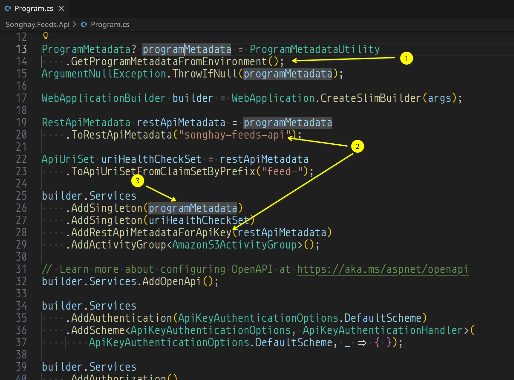
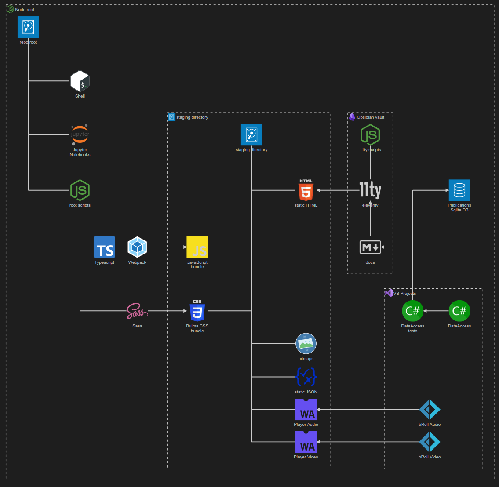

---json
{
  "documentId": 0,
  "title": "studio status report: 2026-09",
  "documentShortName": "2026-09-29-studio-status-report-2026-09",
  "fileName": "index.html",
  "path": "./entry/2026-09-29-studio-status-report-2026-09",
  "date": "2026-09-29T20:37:36.518Z",
  "modificationDate": "2026-09-29T20:37:36.518Z",
  "templateId": 0,
  "segmentId": 0,
  "isRoot": false,
  "isActive": true,
  "sortOrdinal": 0,
  "clientId": "2026-09-29-studio-status-report-2026-09",
  "tag": "{\n  \u0022extract\u0022: \u0022Month 09 of 2026 was about: - re-releasing SonghaySystem.com\\nadding S3 storage support to this Studio\\n\\u201Ccontainerizing\\u201D the smallest Studio workflow\\ngetting to know dapr The incredible (for me) achievements above required the following NuGet package releas\\u2026\u0022\n}"
}
---

# studio status report: 2026-09

Month 09 of 2026 was about:

- re-releasing SonghaySystem.com
- adding S3 storage support to this Studio
- “containerizing” the smallest Studio workflow
- getting to know dapr

The incredible (for me) achievements above required the following NuGet package releases of the month:

- `SonghayCore` [10.4.2](https://www.nuget.org/packages/SonghayCore/10.4.2)
- `SonghayCore.S3 `[10.1.2](https://www.nuget.org/packages/SonghayCore.S3/10.1.2)
- `SonghayCore.Web` [10.0.1](https://www.nuget.org/packages/SonghayCore.Web/10.0.1)

Selected Obsidian notes below should provide some detail:

## today, we should be able to do Songhay Feeds without Aspire… 😐

…and without Docker compose—and without rabbit holes 🐇🕳 Really? Really:

- we can concentrate on containerizing a _single_ ASP.NET minimal <acronym title="Application Programming Interface">API</acronym> app
- we can concentrate on adding a custom health check endpoint
- we can concentrate on the “Job Offloading Pattern” _exclusively_
- we can concentrate on securing the endpoints

## a Songhay Core Web  (C♯) question for Google <acronym title="Artificial Intelligence">AI</acronym>

…`is it okay to build a library project for ASP.NET that is based on Microsoft.NET.Sdk.Web or would this interfere somehow with the main Web project?`

>Using `Microsoft.NET.Sdk.Web` for a class library project is ==generally **not recommended**== and can lead to unexpected build, publishing, and asset-conflicting issues with your main web project. [1](https://stackoverflow.com/questions/70753263/publishing-limitations-when-using-microsoft-net-sdk-web-as-library-project)
> 
> Why You Should Avoid `Microsoft.NET.Sdk.Web` for Libraries
> 
> - **Unintended Outputs and Behaviors:** The Web SDK is explicitly tailored for executable web applications, meaning it expects an entry point and configures specific web targets, static asset handling, and publishing profiles. [1](https://learn.microsoft.com/en-us/aspnet/core/razor-pages/web-sdk?view=aspnetcore-10.0), [2](https://learn.microsoft.com/en-us/aspnet/core/razor-pages/web-sdk?view=aspnetcore-10.0)
> 
> - **Publishing Conflicts:** Developers on [StackOverflow](https://stackoverflow.com/questions/70753263/publishing-limitations-when-using-microsoft-net-sdk-web-as-library-project) point out that using the Web SDK on non-executable library projects frequently introduces publishing bugs—such as misbehaving content files, redundant manifest generation, or conflicting `wwwroot` assets when referenced by a true top-level web host. [1](https://stackoverflow.com/questions/70753263/publishing-limitations-when-using-microsoft-net-sdk-web-as-library-project)
> 
> The Recommended Alternative
> 
> Instead of changing the project SDK, use the standard `Microsoft.NET.Sdk` and explicitly include the ASP.NET Core framework reference inside your library's `.csproj` file: [1](https://stackoverflow.com/questions/75526254/net-6-0-web-sdk-class-library-creation)

```xml
<Project Sdk="Microsoft.NET.Sdk">

  <PropertyGroup>
    <TargetFramework>net10.0</TargetFramework>
  </PropertyGroup>

  <ItemGroup>
    <FrameworkReference Include="Microsoft.AspNetCore.App" />
  </ItemGroup>

</Project>
```

>This approach gives your class library full access to ASP.NET Core APIs (like controllers, middleware, or filters) without the baggage and interference of the Web application SDK. If your library specifically handles UI components like Razor pages or views, use `Microsoft.NET.Sdk.Razor` instead. [1](https://learn.microsoft.com/en-us/aspnet/core/blazor/components/class-libraries?view=aspnetcore-10.0), [2](https://learn.microsoft.com/en-us/aspnet/core/fundamentals/target-aspnetcore?view=aspnetcore-10.0), [3](https://learn.microsoft.com/en-us/aspnet/core/razor-pages/sdk?view=aspnetcore-10.0)

## Mukesh Murugan: “Health Checks in ASP.NET Core: A Complete Guide (.NET 10)”

>Health checks in ASP.NET Core are HTTP endpoints that report whether your app and its dependencies (database, cache, external APIs) are actually working. You register them with `builder.Services.AddHealthChecks()` and expose them with `app.MapHealthChecks("/health")`. On .NET 10 the basic setup needs zero extra NuGet packages: it ships in the ASP.NET Core shared framework.
>
>That is the one-liner answer. But a health endpoint that returns `Healthy` because the process is running, while the database behind it is on fire, is worse than no health check at all. It tells your load balancer and orchestrator to keep sending traffic to a broken pod. So this guide goes past the one-liner: real database and Redis checks, custom `IHealthCheck` logic, a proper JSON response, a live dashboard, and the three things most tutorials skip entirely - the liveness/readiness split that can take down a cluster, what your probes actually cost your database, and how to drain traffic before a pod shuts down.
>
>—“[Health Checks in ASP.NET Core: A Complete Guide (.NET 10)](https://codewithmukesh.com/blog/health-checks-in-aspnet-core/)”
>

## Songhay Feeds: the new `ProgramMetadata` conventions

<div style="text-align:center">



</div>

1. The `GetProgramMetadataFromEnvironment()` method is a new convention for getting `ProgramMetadata` independently of infrastructure like `IConfiguration`.
2. This is a solution to the problem of uniquely identifying `RestApiMetadata` for each <acronym title="Application Programming Interface">API</acronym> built in this Studio and then keying it to `ApiKeyAuthenticationHandler` with a <acronym title="Dependency Injection">DI</acronym> key that does not have to be remembered.
3. Even though `restApiMetadata` is a subset of `ProgramMetadata` the key for `restApiMetadata` (`"songhay-feeds-api"`) should not be known to `ApiKeyAuthenticationHandler`  in `Songhay.Web`.

## a very, very fundamental reason why .NET lost to Go (so far) 😐💡

According to Google <acronym title="Artificial Intelligence">AI</acronym>, containers shipping Go are always _smaller_ than .NET equivalents which implies that Microsoft’s non-competitive cloud storage costs (`Gen2` storage required by default) are suicidal:

…`are containers running a Golang-based API smaller than a .NET AOT API equivalent?`

>Yes, containers running a Golang-based API are generally smaller than an equivalent .NET Native AOT (Ahead-of-Time) API container. [1](https://www.reddit.com/r/dotnet/comments/14kv253/if_youre_versed_in_both_go_and_c_for_web_api/)
> 
> While .NET Native AOT dramatically shrinks container sizes compared to standard JIT-based .NET runtimes, Go binaries and their base images still hold a distinct size advantage. [1](https://www.linkedin.com/posts/kenneth-u-777075131_golang-dotnet-backenddevelopment-activity-7461776785731452928-CLeg), [2](https://www.reddit.com/r/dotnet/comments/14kv253/if_youre_versed_in_both_go_and_c_for_web_api/)
> 
> Size Breakdown
> 
> - **Golang Containers**: A basic Go API compiled statically with flags to strip debugging symbols (`-ldflags="-w -s"`) can be placed inside a `scratch` (empty) or trivial Alpine base image. The final container image is typically **5 MB to 15 MB**. [1](https://medium.com/code-beyond/dockerizing-golang-apps-a-step-by-step-guide-to-reducing-docker-image-size-306898e7359e), [2](https://dev.to/bhargab/reducing-docker-image-size-a-journey-of-discovery-2cd2), [3](https://libozeng.com/2021-1-7-benchmarking-dotnet-golang.html)
> - **.NET Native AOT Containers**: A minimal ASP.NET Core API compiled via Native AOT requires a stripped-down base like Microsoft's `runtimedeps` or Alpine images. Even with aggressive trimming, the native .NET executable and required fundamental system dependencies (like `libc` and `libssl`) usually push the final container image to **15 MB to 30 MB** (and often larger depending on the specific NuGet packages used). [1](https://medium.com/c-sharp-programming/all-the-net-core-opsy-things-37b2e21eabb4), [2](https://dev.to/mfund0/choosing-the-right-net-image-for-your-workloads-2ino)
> 
> Why Go is Smaller
> 
> - **No Heavy Framework Initialization**: Go's standard library and runtime scheduler compiled into a binary add very little overhead.
> - **Base Image Flexibility**: Go allows deployments straight onto `FROM scratch`, meaning zero extra operating system layers.
> - **Generic Specialization Overhead**: .NET Native AOT duplicates specialized native code for various value-type generics and bundles parts of its internal runtime/garbage collector directly into the compiled output. [1](https://www.reddit.com/r/dotnet/comments/1b82db4/why_my_executable_bigger_with_net8_aot_than_full/), [2](https://github.com/dev-details/go-lang-docker-image-size-comparison/blob/main/README.md)

BTW: Bing <acronym title="Artificial Intelligence">AI</acronym> answered this question in a similar manner:

>Yes — **Go-based APIs in Docker containers are generally much smaller than .NET AOT APIs** for the same workload, due to Go’s static binary nature and minimal runtime.
> 
> **Example from direct comparison**  
> A GitHub project comparing identical microservices in **.NET 7 Minimal API** and **Go** found:
> 
> - **.NET 7 Minimal API**: ~212 MB Docker image, ~17.8 MB idle RAM
> - **Go API**: ~6.82 MB Docker image, ~2.7 MB idle RAM [Github](https://www.bing.com/ck/a?!&&p=11d5722a8cba032a56dd3e580d6d5205773a59bb0a684827032f5ec9a52909bbJmltdHM9MTc4ODY1MjgwMA&ptn=3&ver=2&hsh=4&fclid=064e6834-a94b-6283-390a-6744a8b0634b&u=a1aHR0cHM6Ly9naXRodWIuY29tL3NhbXVlbC1wb2lyaWVyL2RvdG5ldC1taW5pbWFsLWFwaS12cy1nb2xhbmctcmVzb3VyY2Utc2l6ZQ&ntb=1)
> 
> This shows Go’s image size is **over 30× smaller** than .NET in this case, even without AOT compilation.
> 
> **Why Go is smaller**
> 
> - **Static binaries**: Go compiles to a single executable with no runtime dependencies, so the final image can be as small as the binary itself [dasroot.net](https://www.bing.com/ck/a?!&&p=7835b48e49ccef2e00af482fca733d70f722535324746ab1ecaa8b0221113e71JmltdHM9MTc4ODY1MjgwMA&ptn=3&ver=2&hsh=4&fclid=064e6834-a94b-6283-390a-6744a8b0634b&u=a1aHR0cHM6Ly9kYXNyb290Lm5ldC9wb3N0cy8yMDI2LzAyL2J1aWxkaW5nLW1pbmltYWwtZ28tY29udGFpbmVycy1oaWdoLXRocm91Z2hwdXQtYXBpcy8&ntb=1).
>     
> - **Multi-stage builds**: Developers can use Alpine or scratch images in the final stage, copying only the compiled binary and minimal dependencies [dasroot.net](https://www.bing.com/ck/a?!&&p=7835b48e49ccef2e00af482fca733d70f722535324746ab1ecaa8b0221113e71JmltdHM9MTc4ODY1MjgwMA&ptn=3&ver=2&hsh=4&fclid=064e6834-a94b-6283-390a-6744a8b0634b&u=a1aHR0cHM6Ly9kYXNyb290Lm5ldC9wb3N0cy8yMDI2LzAyL2J1aWxkaW5nLW1pbmltYWwtZ28tY29udGFpbmVycy1oaWdoLXRocm91Z2hwdXQtYXBpcy8&ntb=1).
> - **No managed runtime**: Unlike .NET, which bundles the CLR, JIT, and AOT runtime, Go’s runtime is tiny and optional.
> 
> **Why .NET AOT is larger**
> 
> - **Runtime overhead**: Even with AOT, .NET still includes the runtime, JIT, and framework libraries.
> - **Dependency bundling**: AOT compiles the app to native code but still ships the runtime and dependencies.
> - **Image layers**: .NET images often use larger base images (e.g., `mcr.microsoft.com/dotnet/aspnet:latest`) compared to minimal Go builders.
> 
> **Practical takeaway**  
> If your goal is to minimize container footprint, Go is the clear winner. For the same API logic, you can achieve **~6–8 MB images** with Go vs **~200 MB+** with .NET AOT. This is especially important for serverless, edge, or constrained environments where image size directly impacts cost and deployment speed.
> 
> **Tip**: To maximize Go’s size advantage, use multi-stage builds with Alpine or scratch, strip debug symbols (`-ldflags="-s -w"`), and avoid unnecessary dependencies [dasroot.net](https://www.bing.com/ck/a?!&&p=7835b48e49ccef2e00af482fca733d70f722535324746ab1ecaa8b0221113e71JmltdHM9MTc4ODY1MjgwMA&ptn=3&ver=2&hsh=4&fclid=064e6834-a94b-6283-390a-6744a8b0634b&u=a1aHR0cHM6Ly9kYXNyb290Lm5ldC9wb3N0cy8yMDI2LzAyL2J1aWxkaW5nLW1pbmltYWwtZ28tY29udGFpbmVycy1oaWdoLXRocm91Z2hwdXQtYXBpcy8&ntb=1).

### related reading

- “[Golang vs C#: Top Differences for Real‑World Engineering in 2026](https://thelinuxcode.com/golang-vs-c-top-differences-for-realworld-engineering-in-2026/)”
- “[Technical Evaluation: .NET Core vs. Go for Enterprise REST APIs in the UAE](https://www.linkedin.com/pulse/technical-evaluation-net-core-vs-go-enterprise-rest-apis-ali-anwar-xms6f/)”
- “[Golang vs C#: Backend Battle - What Top Companies Choose](https://www.netguru.com/blog/golang-vs-c-sharp)”

## Songhay Feeds: container MSBuild properties ❄✨ should be associated with project-file assembly ‘credits’

Reading “[Containerize a .NET app reference](https://learn.microsoft.com/en-us/dotnet/core/containers/publish-configuration)” I see the following MSBuild properties that should be included (except for the last two):

- `ContainerImageTag` 📖 [docs](https://learn.microsoft.com/en-us/dotnet/core/containers/publish-configuration#containerimagetag)🔖
- `ContainerRegistry` 📖 [docs](https://learn.microsoft.com/en-us/dotnet/core/containers/publish-configuration#containerregistry)🔖
- `ContainerRepository` 📖 [docs](https://learn.microsoft.com/en-us/dotnet/core/containers/publish-configuration#containerrepository)🔖
- `LocalRegistry` 📖 [docs](https://learn.microsoft.com/en-us/dotnet/core/containers/publish-configuration#localregistry)🔖
- `ContainerEnvironmentVariable` 📖 [docs](https://learn.microsoft.com/en-us/dotnet/core/containers/publish-configuration#containerenvironmentvariable)🔖
- `ContainerPort` 📖 [docs](https://learn.microsoft.com/en-us/dotnet/core/containers/publish-configuration#containerport)🔖 (can be replaced by ASP.NET environment variables like `HTTP_PORTS`)
- `ContainerLabel` 📖 [docs](https://learn.microsoft.com/en-us/dotnet/core/containers/publish-configuration#containerlabel)🔖 the compiler did _not_ like the documented <acronym title="Extensible Markup Language">XML</acronym> declaration so this was removed (also, some of these labels are generated automatically; see “[Default container labels](https://learn.microsoft.com/en-us/dotnet/core/containers/publish-configuration#default-container-labels)”)

```xml
<PropertyGroup>
    <AssemblyVersion>10.0.0</AssemblyVersion>

    <Title>Songhay Feeds API</Title>
    <Description>API Host for the Studio syndication feeds aggregator.</Description>
    <Authors>Bryan D. Wilhite</Authors>
    <Copyright>(c) 2026 Bryan D. Wilhite</Copyright>
    <Company>Songhay System</Company>

    <ContainerImageTag>10.0.0</ContainerImageTag>
    <ContainerRepository>BryanWilhite/Songhay.Feeds</ContainerRepository>
    <LocalRegistry>Podman</LocalRegistry>
</PropertyGroup>

<ItemGroup>
    <ContainerEnvironmentVariable Include="ASPNETCORE_ENVIRONMENT" Value="Production" />
    <ContainerEnvironmentVariable Include="DOTNET_ENVIRONMENT" Value="Production" />
    <ContainerEnvironmentVariable Include="HTTP_PORTS" Value="8080" />
    <ContainerEnvironmentVariable Include="SONGHAY_APP_SETTINGS" Value="{}" />
</ItemGroup>
```

## Quartz.NET: I am getting <acronym title="ahead of time">AOT</acronym> tree-shaking warnings when building Songhay Feeds 😐

Of course I assume these are harmless:

```console
Songhay.Feeds.Api net10.0 linux-x64 succeeded with 9 warning(s) (94.9s) → Songhay.Feeds.Api/bin/Release/net10.0/linux-x64/publish/ ~/sourceRoot/Songhay.Feeds/Songhay.Web/ProgramMetadataUtility.cs(25): Trim analysis warning IL2026: Songhay.Web.ProgramMetadataUtility.GetProgramMetadataFromEnvironment(): Using member 'System.Text.Json.JsonSerializer.Deserialize<ProgramMetadata>(String,JsonSerializerOptions)' which has 'RequiresUnreferencedCodeAttribute' can break functionality when trimming application code. JSON serialization and deserialization might require types that cannot be statically analyzed. Use the overload that takes a JsonTypeInfo or JsonSerializerContext, or make sure all of the required types are preserved. ~/sourceRoot/Songhay.Feeds/Songhay.Web/ProgramMetadataUtility.cs(25): AOT analysis warning IL3050: Songhay.Web.ProgramMetadataUtility.GetProgramMetadataFromEnvironment(): Using member 'System.Text.Json.JsonSerializer.Deserialize<ProgramMetadata>(String,JsonSerializerOptions)' which has 'RequiresDynamicCodeAttribute' can break functionality when AOT compiling. JSON serialization and deserialization might require types that cannot be statically analyzed and might need runtime code generation. Use System.Text.Json source generation for native AOT applications. ~/.nuget/packages/quartz/4.0.0/lib/net10.0/Quartz.dll : warning IL2104: Assembly 'Quartz' produced trim warnings. For more information see https://aka.ms/il2104
    ILC : Trim analysis warning IL2026: Quartz.Configuration.QuartzPropertyBridge.ApplyStringProperties(Object,IServiceProvider,Object,String,String[]): Using member 'Quartz.Configuration.PropertyBinder.SetObjectProperties(Object,NameValueCollection)' which has 'RequiresUnreferencedCodeAttribute' can break functionality when trimming application code. Component properties are set by name on a type Quartz is handed at run time; a component named by a quartz.* configuration key, and the properties that key sets, are not guaranteed to survive trimming.
    ILC : Trim analysis warning IL2026: Quartz.Impl.AdoJobStore.Common.ConfigurationBasedDbMetadataFactory.GetDbMetadata(String): Using member 'Quartz.Configuration.PropertyBinder.SetObjectProperties(Object,NameValueCollection)' which has 'RequiresUnreferencedCodeAttribute' can break functionality when trimming application code. Component properties are set by name on a type Quartz is handed at run time; a component named by a quartz.* configuration key, and the properties that key sets, are not guaranteed to survive trimming. ~/.nuget/packages/songhaycore.s3/10.0.3/lib/net10.0/SonghayCore.S3.dll : warning IL2104: Assembly 'SonghayCore.S3' produced trim warnings. For more information see https://aka.ms/il2104 ~/.nuget/packages/songhaycore.s3/10.0.3/lib/net10.0/SonghayCore.S3.dll : warning IL3053: Assembly 'SonghayCore.S3' produced AOT analysis warnings.
    ILC : Trim analysis warning IL2026: Quartz.Util.ValueConverter.ConvertValueIfNecessary(Type,Object): Using member 'Quartz.Util.ValueConverter.ConvertUsingTypeConverter(Type,Object)' which has 'RequiresUnreferencedCodeAttribute' can break functionality when trimming application code. A value whose type does not match the target's is converted through TypeDescriptor, which finds the converter by reflecting over the target type; neither that type nor its converter is guaranteed to survive trimming.
    ILC : Trim analysis warning IL2026: Quartz.Configuration.SchedulerPluginFactory.ApplyProperties(ISchedulerPlugin,Type,String,NameValueCollection): Using member 'Quartz.Configuration.PropertyBinder.SetObjectProperties(Object,NameValueCollection)' which has 'RequiresUnreferencedCodeAttribute' can break functionality when trimming application code. Component properties are set by name on a type Quartz is handed at run time; a component named by a quartz.* configuration key, and the properties that key sets, are not guaranteed to survive trimming.

Build succeeded with 9 warning(s) in 103.8s
```
🐰🕳

## Songhay Core (C♯): #new-branch

**New branch:** <https://github.com/BryanWilhite/SonghayCore/tree/dev/version-10.2.0>

<acronym title="pull request">PR</acronym>: <https://github.com/BryanWilhite/SonghayCore/pull/207>

Version `10.2.0` changes are proposed across:

- `SonghayCore`
- `SonghayCore.S3`
- adding `SonghayCore.Web` 🚜✨

### `SonghayCore` changes

- add new `Storage*` models that help to blur the distinction between cloud and local storage operations 🚜✨ [issue #205](https://github.com/BryanWilhite/SonghayCore/issues/205) ✅
- add new `ProgramFile*` Activities designed to ‘impersonate’ corresponding S3 Activities 🚜✨ [issue #206](https://github.com/BryanWilhite/SonghayCore/issues/206) ✅
- all asynchronous Activity abstractions should support `CancellationToken`, [issue #202](https://github.com/BryanWilhite/SonghayCore/issues/202) (🚨 breaking change) ✅
- add `ValueTask` abstractions for Activity interfaces 🚜✨ (added to [issue #202](https://github.com/BryanWilhite/SonghayCore/issues/202)) ✅
- remove `HttpClientLazy` member from `HttpRequestMessageExtensions`, [issue #204](https://github.com/BryanWilhite/SonghayCore/issues/204) (🚨 breaking change)

### `SonghayCore.S3` changes

- change existing S3 Activities to use the new `Storage*` models 🔨  (🚨 breaking change)

### adding the `SonghayCore.Web` package

In recognition of ASP.NET minimal Web API apps with <acronym title="ahead of time">AOT</acronym> compilation (for containerized apps mostly), we add `SonghayCore.Web` which brings the following:

- an API-key authentication model and handler
- Health Checks and Health-Check extension methods
- Serialization contexts for select Songhay models

## S3: why `S3Object` does not have “create” or last-access times

…`why does S3Object not have access or creation times?`

Google <acronym title="Artificial Intelligence">AI</acronym>:

>Amazon S3 objects do not track individual **access times** or **creation times** because ==doing so at massive cloud scale would introduce massive performance bottlenecks and high storage overhead==.
> 
> Why There Is No Access Time
> 
> - **Performance Overhead:** Tracking every `GET` or `HEAD` request means updating metadata for every single read operation. In a distributed, high-throughput system like S3, writing a new timestamp for every read across trillions of objects would slow down read performance and increase latency.
> - **Scale and Consistency:** S3 is designed for high availability and strong consistency across distributed data centers. Constantly updating read timestamps for reads would generate an immense volume of internal metadata write operations.
> - **Alternative Solutions:** Instead of real-time tracking, AWS provides [S3 Inventory](https://docs.aws.amazon.com/AmazonS3/latest/userguide/about-object-inspection.html), S3 Storage Class Analysis, and server access logs to help analyze usage patterns asynchronously. [1](https://stackoverflow.com/questions/19357470/aws-storage-s3-object-go-to-glacier-if-never-accessed-in-the-last-month), [2](https://repost.aws/articles/ARUxLc543iRKGmzjJDcyqF_g/unlocking-efficient-data-lifecycle-management-for-amazon-s3-with-last-access-times), [3](https://aws.amazon.com/blogs/architecture/expiring-amazon-s3-objects-based-on-last-accessed-date-to-decrease-costs/)
> 
> Why There Is No Creation Time (Strictly Speaking)
> 
> - **Last-Modified as Creation:** S3 _does_ provide a **Last-Modified** timestamp. For a standard, single-operation upload (`PUT`), the `Last-Modified` time is effectively the creation time. [1](https://repost.aws/articles/ARUxLc543iRKGmzjJDcyqF_g/unlocking-efficient-data-lifecycle-management-for-amazon-s3-with-last-access-times)
> - **Distributed Overwrites:** Because S3 supports overwriting existing object keys (`PUT` requests with the same name), an object can be updated in place. Maintaining a separate immutable "creation time" alongside "last modified" adds extra metadata overhead that AWS chose to streamline into a single primary timestamp for storage management and [S3 Lifecycle](https://docs.aws.amazon.com/AmazonS3/latest/userguide/object-lifecycle-mgmt.html) rules. [1](https://docs.aws.amazon.com/AmazonS3/latest/userguide/object-lifecycle-mgmt.html), [2](https://docs.aws.amazon.com/AmazonS3/latest/userguide/troubleshoot-lifecycle.html), [3](https://repost.aws/articles/ARUxLc543iRKGmzjJDcyqF_g/unlocking-efficient-data-lifecycle-management-for-amazon-s3-with-last-access-times)

## Google <acronym title="Artificial Intelligence">AI</acronym> appears to have some awesome dapr news 😐📰

…`can dapr workflows run without a container environment and then be containerized later?`

>**Yes, Dapr Workflows can run entirely without a container environment and then be containerized later.**
> 
> Because [Dapr](https://dapr.io/) decouples your application logic from the underlying hosting infrastructure, your workflow code remains identical whether it runs as a raw local process or inside a production Kubernetes cluster. [1](https://dapr.io/), [2](https://docs.dapr.io/operations/hosting/kubernetes/kubernetes-production/)
> 
> Phase 1: Running Without Containers (Local Development)
> 
> To run Dapr Workflows without Docker or Podman, you utilize Dapr's **Slim Initialization** mode. This downloads the Dapr runtime directly onto your host machine as standard executables. [1](https://docs.dapr.io/operations/hosting/self-hosted/self-hosted-no-docker/)
> 
> - **Initialize Dapr in Slim Mode:**

```bash
dapr init --slim
```

>- This installs the `daprd` (sidecar) and `placement` (actor orchestration) binaries directly to your local file system without spinning up any containers. [1](https://www.bookstack.cn/read/dapr-1.2-en/cdd9c8bdccf56f5d.md), [2](https://docs.dapr.io/operations/hosting/self-hosted/self-hosted-no-docker/)
> 
> - **Set Up a Local State Store:**  
>     Dapr Workflows are stateful and rely on an underlying Dapr actor state store (such as SQLite, PostgreSQL, or Redis). In slim mode, you must point your component YAML file to a database running natively on your host machine (e.g., a locally installed PostgreSQL or SQLite instance) instead of a Docker container. [1](https://docs.dapr.io/developing-applications/building-blocks/workflow/workflow-architecture/), [2](https://www.bookstack.cn/read/dapr-1.2-en/cdd9c8bdccf56f5d.md)
> - **Run Your Workflow:**  
>     Execute your workflow application using the Dapr CLI. Dapr will launch alongside your application as a standard OS process:

```bash
dapr run --app-id workflow-app --resources-path ./components -- dotnet run
```
> - [1](https://docs.dapr.io/operations/hosting/self-hosted/self-hosted-overview/), [2](https://docs.diagrid.io/dapr-open-source/)
> 
> Phase 2: Containerizing Later (Production Shift)
> 
> When you are ready to containerize your architecture, **zero changes** are required for your core workflow code. You only shift your configuration and deployment target.
>The migration path involves three straightforward steps:
> 
> - **Step 1: Package your app.** Wrap your workflow code inside a standard `Dockerfile` (e.g., targeting Node, .NET, Python, or Go). [1](https://jettro.dev/learning-dapr-by-building-a-case-management-system-0f44d71109db)
> - **Step 2: Update component files.** Change your Dapr component YAML files to point from your local development databases to your production-grade cloud databases or containerized state stores. [1](https://dapr.io/)
> - **Step 3: Deploy.** Deploy your application container into an environment like Kubernetes. If using Kubernetes, the Dapr Sidecar Injector will automatically inject the `daprd` container right next to your application container. [1](https://docs.dapr.io/concepts/dapr-services/sidecar/), [2](https://dapr.io/)
> 
> Critical Considerations for Workflows
> 
> - **The Placement Service:** Dapr Workflows depend on Dapr Actors behind the scenes. If running without containers, make sure you manually start the local placement binary (`dapr-placement`) so your workflows can track state and execute reliably. [1](https://docs.dapr.io/operations/hosting/self-hosted/self-hosted-overview/), [2](https://docs.dapr.io/developing-applications/building-blocks/workflow/workflow-architecture/), [3](https://www.bookstack.cn/read/dapr-1.2-en/cdd9c8bdccf56f5d.md)
> - **State Persistence:** When migrating to a containerized environment, ensure your production state store has access to the historical event-sourcing data if you intend to resume inflight workflows seamlessly. [1](https://www.reddit.com/r/dotnet/comments/13ydqyr/understanding_the_dapr_workflow_engine_and/)

…`does dapr have any issues running with podman instead of docker?`

>==**No, Dapr does not have major issues running with Podman**==, as it officially supports it as an alternative container runtime. The core Dapr sidecar runtime (`daprd`) itself has zero dependencies on Docker; the container runtime is only utilized by the Dapr CLI during local self-hosted initialization to stand up support containers like Redis and Zipkin. [1](https://github.com/dapr/cli/issues/257), [2](https://docs.dapr.io/operations/hosting/self-hosted/self-hosted-overview/)
> 
> However, because Podman operates differently than Docker—primarily around its rootless architecture and networking—there are a few critical nuances and known behaviors you should keep in mind:
> 
> 1. Explicit CLI Flags Required
> 
> The Dapr CLI defaults to Docker. If you try to run a standard initialization, it will fail with a "could not connect to docker" error. You must explicitly tell the CLI to target Podman: [1](https://github.com/dapr/cli/issues/1185), [2](https://docs.dapr.io/operations/troubleshooting/common_issues/), [3](https://oneuptime.com/blog/post/2026-03-31-dapr-podman/view), [4](https://docs.dapr.io/operations/hosting/self-hosted/self-hosted-overview/)
> 
> - **Initialization:** `dapr init --container-runtime podman`
> 
> - **Uninstallation:** `dapr uninstall --container-runtime podman --all` [1](https://docs.dapr.io/operations/hosting/self-hosted/self-hosted-with-podman/), [2](https://v1-14.docs.dapr.io/operations/hosting/self-hosted/self-hosted-with-podman/)
> 
> _(Note: Commands like `dapr run` and `dapr stop` interact with local processes rather than the container daemon directly, so they work identically regardless of your container choice.)_ [1](https://oneuptime.com/blog/post/2026-03-31-dapr-podman/view)
> 
> 2. Rootless Networking & Localhost Gotchas
> 
> By default, Podman runs in **rootless mode**. This introduces isolated network namespaces, meaning containers do not naturally share a localhost network interface with your host machine. [1](https://www.reddit.com/r/selfhosted/comments/1wamslb/docker_vs_podman/), [2](https://docs.dapr.io/operations/hosting/self-hosted/self-hosted-with-podman/)
> 
> - **The Issue:** Your application running on the host might struggle to talk to the Dapr sidecar, or the sidecar components (like Redis) might not resolve properly if they rely on standard container bridge networking. [1](https://oneuptime.com/blog/post/2026-03-31-dapr-podman/view)
> 
> - **The Fix:** When manually launching Dapr containers or defining component files, you may need to use Podman’s host networking mode (`--network="host"`) so that Dapr and your application can share the localhost interface, or explicitly hardcode the container IP addresses in your component YAML files. [1](https://docs.dapr.io/operations/hosting/self-hosted/self-hosted-with-podman/), [2](https://oneuptime.com/blog/post/2026-03-31-dapr-podman/view)
> 
> 3. Docker Socket Emulation
> 
> Some workflows or extension tools expect a classic Docker daemon socket (`/var/run/docker.sock`). To make Dapr work transparently without configuration errors, you often need to ensure Podman's system service is running and point your `DOCKER_HOST` environment variable to Podman’s socket. [1](https://oneuptime.com/blog/post/2026-03-31-dapr-self-hosted-podman/view), [2](https://docs.dapr.io/operations/troubleshooting/common_issues/)
> 
> 4. Podman Compose vs. Docker Compose
> 
> If you utilize multi-service local development files, Podman supports the standard `docker-compose.yaml` format. However, the community implementation (`podman-compose`) can occasionally lag behind the official Docker Compose specification on advanced features, which might require manual tweaks if you have highly complex setup configurations. [1](https://www.reddit.com/r/selfhosted/comments/1wamslb/docker_vs_podman/), [2](https://oneuptime.com/blog/post/2026-03-31-dapr-podman/view)

### related reading

- “[How-To: Run Dapr in an offline or airgap environment](https://docs.dapr.io/operations/hosting/self-hosted/self-hosted-airgap/)”
- “[How-To: Run Dapr in self-hosted mode without Docker](https://docs.dapr.io/operations/hosting/self-hosted/self-hosted-no-docker/)”

## Songhay Core (C♯): issue #204 led to adding `Microsoft.Extensions.Http` 📦✨

The `Microsoft.Extensions.Http` NuGet [package](https://www.nuget.org/packages/Microsoft.Extensions.Http) was needed for [issue #204](https://github.com/BryanWilhite/SonghayCore/issues/204) in order to introduce `IHttpClientFactory` from the `System.Net.Http` namespace 📖 [docs](https://learn.microsoft.com/en-us/dotnet/api/system.net.http?view=net-11.0-pp)🔖 to the Core. In the current manifestation of .NET, `IHttpClientFactory` is the first abstraction we turn to for obtaining `HttpClient`:

>`HttpClient` instances are meant to be **long-lived**, and reused throughout the lifetime of the application.
>
>Each instance uses its own **connection pool** for isolation purposes, but also to prevent **port exhaustion**. If a server is under high load, and your application is constantly creating new connections, it could lead to exhausting the available ports. This will cause an exception at runtime, when trying to send a request.
>
>…
>
>Instead of managing the `HttpClient` lifetime yourself, you can use an **`IHttpClientFactory`** to create the `HttpClient` instance.
> 
> Simply call the `CreateClient` method and use the returned `HttpClient` instance to send your HTTP requests.
> 
> Why is this a better approach?
> 
> The expensive part of the `HttpClient` is the actual message handler - `HttpMessageHandler`. Each `HttpMessageHandler` has an internal HTTP **connection pool** that can be reused.
> 
> The `IHttpClientFactory` will **cache** the `HttpMessageHandler` and reuse it when creating a new `HttpClient` instance.
> 
> An important note here is that `HttpClient` instances created by `IHttpClientFactory` are meant to be **short-lived**.
>
>—”[The Right Way To Use HttpClient In .NET](https://milanjovanovic.tech/blog/the-right-way-to-use-httpclient-in-dotnet)”
>

What? Why are `HttpClient` instances `IHttpClientFactory` short lived while “`HttpClient` instances are meant to be **long-lived**”? Today I think the answer to this question is we actually need that “HTTP **connection pool**” to be long lived and shared #to-do 

## JavaScript `Date` method drama 😐📆

Reminders:

- `getUTCMonth()` 📖 [docs](https://developer.mozilla.org/en-US/docs/Web/JavaScript/Reference/Global_Objects/Date/getUTCMonth)🔖 is zero based; I am currently adding one to its output for expected results
- `getUTCDay()` 📖 [docs](https://developer.mozilla.org/en-US/docs/Web/JavaScript/Reference/Global_Objects/Date/getUTCDay)🔖 is zero based; one will likely want `getUTCDate()` 📖 [docs](https://developer.mozilla.org/en-US/docs/Web/JavaScript/Reference/Global_Objects/Date/getUTCDate)🔖 instead

## Quartz.NET drama: `WithDailyTimeIntervalSchedule` configuration defaults to every minute 😐❓

>[!important]
>An interval must be specified for `WithDailyTimeIntervalSchedule` or it will run continually 💸

For Songhay Feeds, see how `.WithInterval(1, IntervalUnit.Day)` is needed to prevent this expensive behavior:

```csharp
        configurator.WithDailyTimeIntervalSchedule(builder =>
            builder
                .OnMondayThroughFriday()
                .StartingDailyAt(
                   TimeOnly.Parse(timeOnlyExpression))
                .WithInterval(24, IntervalUnit.Hour)
                .WithMisfireInstruction(
                DailyTimeIntervalTriggerMisfireInstruction.DoNothing));
```

>[!warning]
>Quartz.NET will throw a _runtime_ error, revealing that `.WithInterval(1, IntervalUnit.Day)` does _not_ work for a _daily_ schedule. Instead we can use hour, minute or second intervals 🙁

I guess “daily time _interval_” was the clue. Quartz.NET issue [#1152](https://github.com/quartznet/quartznet/issues/1152) reveals others had the same misunderstanding 😐💸

## dapr: “An in-depth guide to Dapr workflow patterns in .NET” #to-do 😐

>After covering Dapr workflow basics in the [**previous article**](https://www.diagrid.io/blog/authoring-dapr-workflows-in-dotnet), let’s take a look at the different application patterns that can be used with Dapr workflow and .NET. The patterns covered in this post are: chaining, fan-out/fan-in, monitor, and external system interaction.
>
>…
>
>All code samples shown in this post are taken from the [**dapr-workflow-demos**](https://github.com/diagrid-labs/dapr-workflow-demos) GitHub repo…
>
>—“[An in-depth guide to Dapr workflow patterns in .NET](https://www.diagrid.io/blog/in-depth-guide-to-dapr-workflow-patterns)”
>

## open pull requests on GitHub 🐙🐈

- <https://github.com/BryanWilhite/Songhay.HelloWorlds.Activities/pull/14>

## sketching out development projects



- use a Jupyter Notebook to track finding and changing Amazon links to open source links in the kinté space repo 📓⚙
- use a Jupyter Notebook to convert flickr links to Publications (responsive image) links in the kinté space repo 📓⚙
- convert Songhay Day Path Blog repo to the relevant conventions shown in the diagram above 🔨🚜
- ~~re-release SonghaySystem.com in Astro on Netlify~~ 🚀
- start development of Songhay Publications Index (F♯) experience for WebAssembly 🍱✨
- start development of Songhay Publications - Data Editor to establish a <acronym title="Graphical User Interface">GUI</acronym> for `*Shell` and provide visualizations and interactions for Publications data 🍱✨

🐙🐈<https://github.com/BryanWilhite/>
