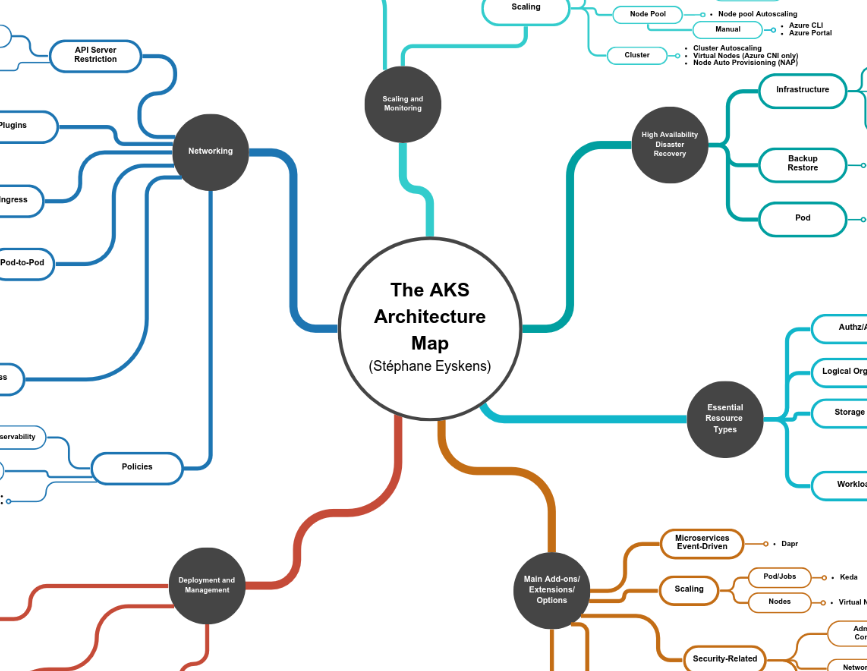
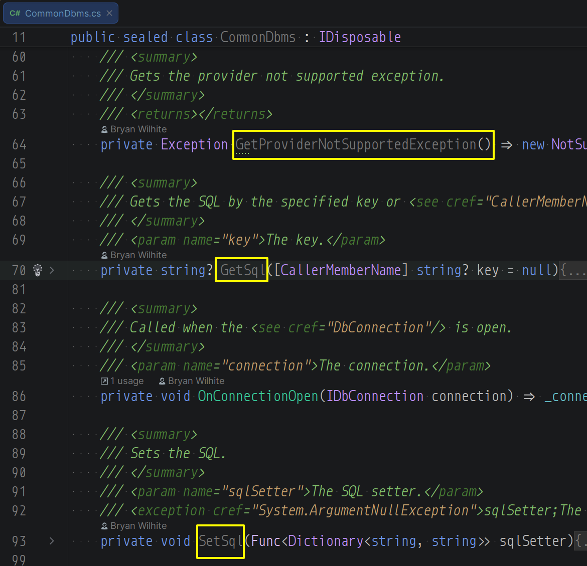
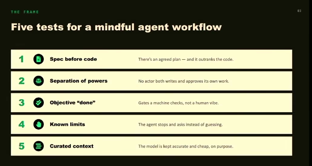
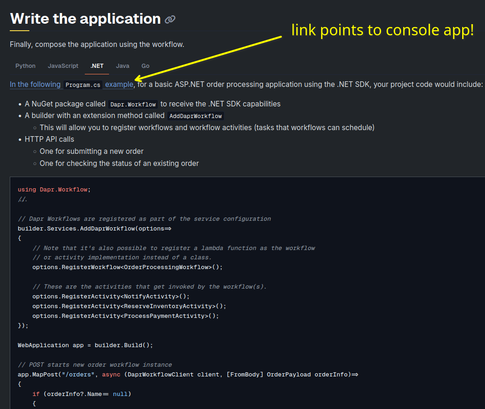
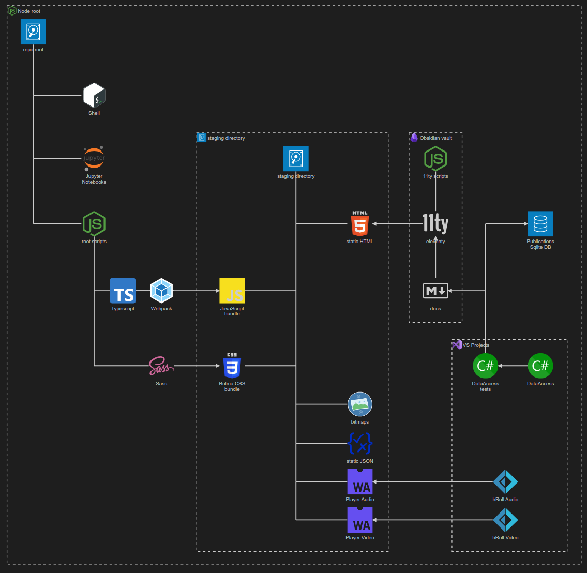

---json
{
  "documentId": 0,
  "title": "studio status report: 2026-10",
  "documentShortName": "2026-10-30-studio-status-report-2026-10",
  "fileName": "index.html",
  "path": "./entry/2026-10-30-studio-status-report-2026-10",
  "date": "2026-10-30T22:05:36.505Z",
  "modificationDate": "2026-10-30T22:05:36.505Z",
  "templateId": 0,
  "segmentId": 0,
  "isRoot": false,
  "isActive": true,
  "sortOrdinal": 0,
  "clientId": "2026-10-30-studio-status-report-2026-10",
  "tag": "{\n  \u0022extract\u0022: \u0022Month 10 of 2026: - converting (too slowly) the Songhay Player back-end to S3 storage\\nbeing introduced to Claude in a new day job This month required the following Studio releases: - Songhay.DataAccess 10.1.0\\nSonghay.Publications 10.1.0\\nSonghay.Publicatio\\u2026\u0022\n}"
}
---

# studio status report: 2026-10

Month 10 of 2026:

- converting (too slowly) the Songhay Player back-end to S3 storage
- being introduced to Claude in a new day job

This month required the following Studio releases:

- `Songhay.DataAccess` [10.1.0](https://www.nuget.org/packages/Songhay.DataAccess/10.1.0)
- `Songhay.Publications` [10.1.0](https://www.nuget.org/packages/Songhay.Publications/10.1.0)
- `Songhay.Publications.DataAccess` [10.1.0](https://www.nuget.org/packages/Songhay.Publications.DataAccess/10.1.0)

Selected notes of this month detail:

## SQLite: “Conflict Free Replicated Data types (CRDTs)” 😐❓

Looks like a novel way to avoid or delay concurrency issues:

>Conflict Free Replicated Data types (CRDTs) can be tricky. You may spend months reading papers and implementing different algorithms before they finally click and become simple. That or they'll seem simple out of the gate and you'll be missing a bunch of nuance.
>
>…
>
>CRDTs are needed in situations where you want multiple processes to modify the same state without coordinating their writes to that state.
>
>Imagine a situation where you have a shared business document. Ideally you, and others, can modify your copies of that document even when internet access is down. When internet is restored, you and your peer's changes can all be merged together without conflict.
>
>—“[Conflict Free Replicated Data types (CRDTs)](https://vlcn.io/blog/intro-to-crdts)”
>

## Publications: “The `<time>` element should actually do something”

>If you’re a pedant about HTML though (like me), then you might use the [`<time>`](https://developer.mozilla.org/en-US/docs/Web/HTML/Reference/Elements/time) element:

```
Post published
<time datetime="2025-12-14T19:30:00.000Z">
  4 hours ago
</time>
```

>This is great! We now have a semantic way to express the exact timestamp of a date. So browsers and screen readers should use this and give us a way to avoid those annoying manual tooltips and… oh wait, no. The `<time>` element does [approximately nothing](https://stackoverflow.com/q/6852866).
>
>—“[The `<time>` element should actually do something](https://nolanlawson.com/2025/12/14/the-time-element-should-actually-do-something/)”
>

## Azure Kubernetes Service: “APIM Hotrod S2E04 - Azure Kubernetes Service with Richard Hooper”

<div style="text-align:center">

<figure>
    <a href="https://www.youtube.com/watch?v=YMPDPhkhdFs">
        
    </a>
    <p><small>APIM Hotrod S2E04 - Azure Kubernetes Service with Richard Hooper</small></p>
</figure>

</div>

The [AKS Architecture Map](https://github.com/PacktPublishing/The-Azure-Cloud-Native-Architecture-Mapbook-Second-Edition/blob/main/Chapter04/maps/AKS%20Architecture.pdf) is featured:

<div style="text-align:center">



</div>

Tools mentioned:

### Azure Kubernetes Fleet Manager

>Azure Kubernetes Fleet Manager enables at-scale management of multiple [supported Kubernetes clusters](https://learn.microsoft.com/en-us/azure/kubernetes-fleet/concepts-member-cluster-types). Fleet Manager provides platform administrators with access to automated safe multi-cluster updates, intelligent Kubernetes resource placement, and a centralized location to access monitoring data for their clusters.
>
>—“[What is Azure Kubernetes Fleet Manager?](https://learn.microsoft.com/en-us/azure/kubernetes-fleet/overview)”
>

### Headlamp

>Headlamp is an easy-to-use and extensible Kubernetes web UI.
>
>Headlamp was created to blend the traditional feature set of other web UIs/dashboards (i.e., to list and view resources) with added functionality.
>
>—<https://github.com/kubernetes-sigs/headlamp>
>

### Inspektor Gadget

>Inspektor Gadget is a set of tools and framework for data collection and system inspection on Kubernetes clusters and Linux hosts using eBPF. It manages the packaging, deployment and execution of Gadgets (eBPF programs encapsulated in OCI images) and provides mechanisms to customize and extend Gadget functionality.
>
>Note: Major new functionality was released in v0.31.0. Please read the blog post for a detailed overview.
>
>—<https://github.com/inspektor-gadget/inspektor-gadget>
>

### AKS Automatic

>Automatic is a new experience for Azure Kubernetes Service (AKS) that lets you create and manage production-ready clusters with minimal effort and added confidence. This means you can focus on developing and running your applications, while AKS handles the rest for you.
>
>—“[AKS Automatic](https://blog.aks.azure.com/2024/05/22/aks-automatic)”
>

## AKS: “AKS on bare metal now on Ubuntu”

>Today, we are announcing the public preview of AKS on bare metal Ubuntu. Customers can now deploy AKS directly on their Ubuntu infrastructure, without installing or operating a hypervisor between Kubernetes and the underlying hardware.
>
>This release extends the AKS experience to organizations that need Kubernetes close to their applications, devices, and data. It is designed for environments such as retail locations, factories, branch sites, telecommunications infrastructure, and on-premises AI systems, where performance, latency, hardware access, or data residency are critical.
>
>—“[AKS on bare metal now on Ubuntu](https://blog.aks.azure.com/2026/09/25/aks-baremetal-ubuntu)”
>

## Songhay Data Access (C♯): why is `CommonDbms` a sealed class?

`CommonDbms` contains members like `GetSql` and `SetSql` that are just waiting to be inherited by a domain-specific subclass but the `sealed` specifier prevents this:

<div style="text-align:center">



</div>

I am not seeing Joplin notes for this; I am not seeing `CommonDbms` mentioned in the issues. So, today, I propose the following:

- [x] define `SqlStatementCollection: Dictionary<string, string>` 🚜✨
- [x] migrate `GetSql` and `SetSql` to `SqlStatementCollection` 🔨
- [x] migrate `GetProviderNotSupportedException()` to an extension method 🚜✨ 

**New issue:** <https://github.com/BryanWilhite/Songhay.DataAccess/issues/16>

## Let’s Encrypt: “Let's Encrypt cuts certificate lifetimes to 64 days starting February 2027”

>Let’s Encrypt is continuing a push toward tighter security by reducing free SSL/TLS certificate lifetimes from 90 days to 64 days, starting February 10, 2027. For administrators already implementing modern [ACME](https://en.wikipedia.org/wiki/Automatic_Certificate_Management_Environment) clients that support [ARI](https://letsencrypt.org/2024/04/25/guide-to-integrating-ari-into-existing-acme-clients) (ACME Renewal Information), the change should be seamless. For those still relying on hardcoded renewal schedules or manual processes, February will be the deadline to update before certificates start expiring unexpectedly.
>
>—“[Let's Encrypt cuts certificate lifetimes to 64 days starting February 2027](https://arstechnica.com/gadgets/2026/10/lets-encrypt-cuts-certificate-lifetimes-to-64-days-starting-february-2027/)”
>

## <acronym title="Role-Based Access Control">RBAC</acronym> _is_ Linux 😐😲

>- **RBAC**, abbreviated from **Role-Based Access Control** was released in December 22, 2000; as part of **SELinux** project which is an abbreviation of _Security-Enhanced Linux_ that is a security architecture for Linux® systems that allows administrators to have more control over who can access the system. ==It was originally developed by the United States National Security Agency (NSA) as a series of patches to the Linux kernel using Linux Security Modules (LSM).== In Kubernetes RBAC is a term that is used to determine the control model of organization operators and applications. Of course there is other control models such as ABAC and PBAC which are not delegated into Kubernetes ecosystem.
>
>—“[Kubernetes is just Linux](https://cms.staas.io/blog/kubernetes-is-just-linux/)”
>

## Microsoft: “Microsoft eXecution Container (MXC)”

>MXC is a **sandboxed code execution system** for running untrusted code (model output, plugins, and tools) on Windows, Linux, and macOS. It provides multiple containment backends, from OS-native process sandboxes to full VMs, behind a unified containment model and typed SDKs.
>
>—<https://github.com/microsoft/mxc>
>

## Firefox: “Fingerprints are the new cookies”

>See, we’ve made a lot of civilizational progress in making browsing safe. [Long gone are the days when getting a virus just by visiting a website was a daily concern](https://www.darkreading.com/vulnerabilities-threats/browser-exploits-wane-users-become-attack-surface). The thing is, the definition of safety varies depending on who you ask. The broad consensus ends at isolation: a website’s code can’t see the data stored by other websites, and it can’t see your files or other applications without permission. **Chrome** and **Edge** stop here. Then you have **Safari** (especially on iOS/macOS 26+) and **Firefox** extending that definition to privacy, ==but they still don’t fully protect you from fingerprinting==. **Brave** and **Tor** are the leading privacy-first browsers, with up and coming **Mullvad Browser** (Mullvad being, in my opinion, one of the best VPN providers out there).
>
>—“[Fingerprints are the new cookies](https://royfish.dev/fingerprints-are-the-new-cookies)”
>

## .NET: “How I Tamed Claude - Emmz Rendle - NDC Copenhagen 2026”

The speaker is spending $200/month on Claude “max”:

<div style="text-align:center">

<figure>
    <a href="https://www.youtube.com/watch?v=GoQzVjk8rzc">
        
    </a>
    <p><small>How I Tamed Claude - Emmz Rendle - NDC Copenhagen 2026</small></p>
</figure>



</div>

1. spec before code
2. separation of powers (no actor writes and approves its own work)
3. objective definition of done
4. the agent stops and asks instead of guessing (burning tokens doing the wrong work)
5. curated context (keeping the model accurate and cheap)

>OpenSpec is a lightweight and configurable framework for creating and managing software specifications.
> 
> With OpenSpec, you capture what you want to build in a spec and keep your team and coding agents aligned as the work evolves. We help you refine the requirements, validate that they describe the right thing, and verify that the implementation matches.
> 
> In essence, OpenSpec helps you [build the right thing and build it right](https://en.wikipedia.org/wiki/Software_verification_and_validation#Definitions).

## .NET: Common Vulnerabilities and Exposures (<acronym title="Common Vulnerabilities and Exposures">CVE</acronym>)

<acronym title="Common Vulnerabilities and Exposures">CVE</acronym> is an industry-wide acronym:

>The mission of the CVE™ Program is to identify, define, and catalog publicly disclosed cybersecurity [vulnerabilities](https://www.cve.org/ResourcesSupport/Glossary?activeTerm=glossaryVulnerability). There is one [CVE Record](https://www.cve.org/ResourcesSupport/Glossary?activeTerm=glossaryRecord) for each vulnerability in the catalog. The vulnerabilities are discovered then assigned and published by organizations from around the world that have partnered with the CVE Program. [Partners](https://www.cve.org/PartnerInformation/ListofPartners) publish CVE Records to communicate consistent descriptions of vulnerabilities. Information technology and cybersecurity professionals use CVE Records to ensure they are discussing the same issue, and to coordinate their efforts to prioritize and address the vulnerabilities.
>
>—<https://www.cve.org/About/Overview>
>

<div style="text-align:center">

<figure>
    <a href="https://www.youtube.com/watch?v=W4T2n_2m7WA">
        
    </a>
    <p><small>CVE Lightning Talk</small></p>
</figure>

</div>

## dapr: the official docs and the official examples run workflows as console applications…

…which implies that there is no great concern or great story to tell about workflows operate across multiple containers. This explains, in part, why Google <acronym title="Artificial Intelligence">AI</acronym> answered my previous question without _any_ references at all.

What is quite disturbing is that, as of today, the official docs actually [show](https://docs.dapr.io/developing-applications/building-blocks/workflow/howto-author-workflow/#write-the-application) a code block for ASP.NET:

<div style="text-align:center">



</div>

But none of the [dapr workflow code samples](https://github.com/dapr/dotnet-sdk/tree/master/examples/Workflow) use ASP.NET 😐 Moreover, [the official workflow walk-through](https://docs.dapr.io/getting-started/quickstarts/workflow-quickstart/) is based on “a simple console application” 🤦 (also, see “[Using the Dapr Workflow API with C#](https://github.com/dapr/quickstarts/blob/master/tutorials/workflow/csharp/README.md)”)

## Ubuntu will support Microsoft Entra ID going forward 😲

>Microsoft single sign-on (SSO) for Linux is powered by the Microsoft Identity Broker, a software component that integrates Linux devices with Microsoft Entra ID. This solution enables users to authenticate once with their Microsoft Entra ID credentials and access multiple applications and resources without repeated authentication prompts. The feature simplifies the sign-in process for users and reduces password management overhead for administrators.
>
>—”[What is Microsoft single sign-on for Linux?](https://learn.microsoft.com/en-us/entra/identity/devices/sso-linux?tabs=password-auth%2Cdebian-install%2Cdebian-update%2Cdebian-uninstall%2Cdebian-sc-example)”
>

## getting to know Claude #day-job

- I _think_ Claude can contextualize from a central “workspace” repo and then run for each “code” repo with its individual `Claude.md` file. (**Update:** I am working with a mono-repo and Claude is being used to setup child repos for dozens and dozens of solutions)
- When encountering a repo cloned for the first time with an existing `Claude.md` file, running `claude init` is _not_ recommended; instead, consider running `/doctor prompt-audit` or just `/doctor` to get a status report of the quality of the `Claude.md` file and the understood context.
- When changing terminals on the same desktop or restarting the desktop, use `claude -c` or `claude --continue` to keep the current context.
- When installing local plugins while a session is open, run `/reload-plugins` to refresh.

>[!important]
>Claude can be asked about the repo in context as an on-boarding experience for a new developer. This is huge! This eclipses my desire to use automated testing to ‘self document’ a repo 😐

## dapr Workflow integration testing means using Testcontainers for .NET 😐🔬

Integration testing requires `Dapr.Testcontainers` which depends on [Testcontainers for .NET](https://dotnet.testcontainers.org/) (see “[Integration testing with Dapr.Testcontainers](https://docs.dapr.io/developing-applications/sdks/dotnet/dotnet-guidance/dotnet-guidance-testcontainers/)”); otherwise, research will lead you into somewhat useless [mocking scenarios](https://github.com/dapr/dotnet-sdk/blob/master/examples/Workflow/WorkflowUnitTest/OrderProcessingTests.cs).

## open pull requests on GitHub 🐙🐈

- <https://github.com/BryanWilhite/Songhay.HelloWorlds.Activities/pull/14>

## sketching out development projects



- use a Jupyter Notebook to track finding and changing Amazon links to open source links in the kinté space repo 📓⚙
- use a Jupyter Notebook to convert flickr links to Publications (responsive image) links in the kinté space repo 📓⚙
- convert Songhay Day Path Blog repo to the relevant conventions shown in the diagram above 🔨🚜
- start development of Songhay Publications Index (F♯) experience for WebAssembly 🍱✨
- start development of Songhay Publications - Data Editor to establish a <acronym title="Graphical User Interface">GUI</acronym> for `*Shell` and provide visualizations and interactions for Publications data 🍱✨

🐙🐈<https://github.com/BryanWilhite/>
